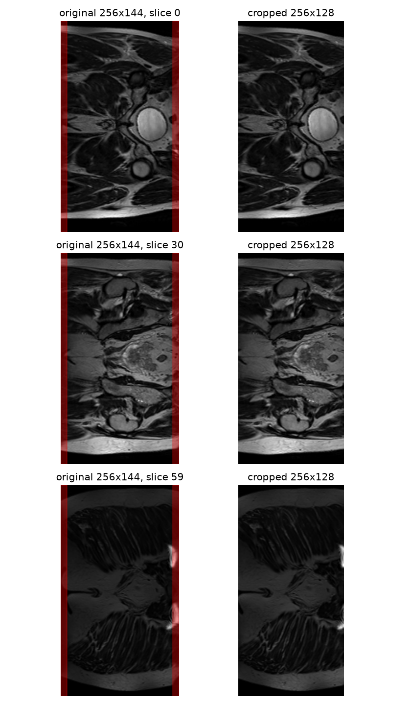

# VQ-VAE2 for Synthetic HipMRI 2D Slice Generation

## 1. Problem and Motivation

## 2. Method
### 2.1 VQ-VAE2 (hierarchical encoder, codebooks, decoder)
### 2.2 PixelCNN Prior (generating new code maps)
### 2.3 Baseline (plain autoencoder, no codebook)

## 3. Feasibility Review

## 4. Data
### 4.1 Dataset
- HipMRI Study 2D slices (keras_slices_data on Rangpur), NIfTI (.nii.gz), float32
- Naming: case_<patient>_week_<scan>_slice_<n>; masks: seg_<patient>_week_<scan>_slice_<n>
### 4.2 Preprocessing
- Per-slice min-max normalisation to [0, 1] (the grayscale channel has no fixed scale, e.g. 0–478)
- Shape check over all slices: one training scan ('case_019_week_1', 60 slices) is 256×144; all others 256×128
- Tried centre-cropping it to 256×128, then checked against the masks: the removed columns contain labelled
  anatomy (205,288 labelled pixels across 60 slices; brightest pixel of some slices lies in the strips)

- Decision: exclude case_019_week_1 (0.5% of training slices). Patient 019 stays in training via their other scans.
I rejected cropping (cuts anatomy), resizing (distorts anatomy), padding all other slices to 144 (adds artificial borders); and moreover 60 of 11,460 slices is 0.5%, and in the cropped version only the 8-pixel edges of those slices differ. That effect is far smaller than the ordinary variation we'll get from random initialisation and shuffling.
### 4.3 Split
- Provided split used: 31 / 4 / 3 patients, 11,460 / 660 / 540 slices, 60 slices per scan
- Verified patient-level: zero patient overlap between train, validate and test

## 5. Dependencies

## 6. Usage
### 6.1 Training
### 6.2 Inference / Sampling

## 7. Results
### 7.1 Example Inputs and Outputs
### 7.2 Training Curves
### 7.3 Baseline vs VQ-VAE2
### 7.4 Memorisation Audit (nearest-neighbour analysis)
### 7.5 Resource Profiling

## 8. Failure Autopsies

## 9. Recommendation

## 10. Artificial Intelligence Usage Disclosure

## References